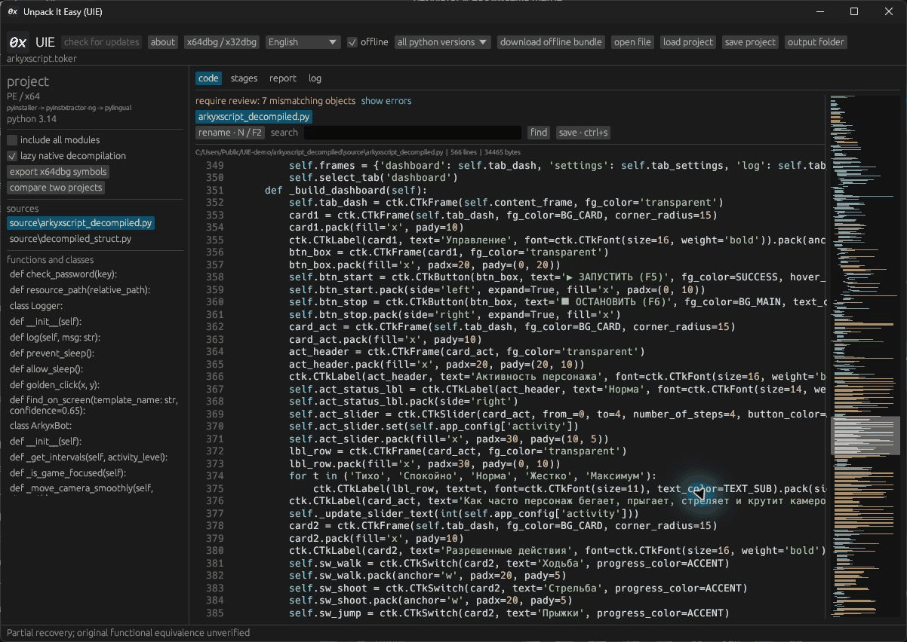
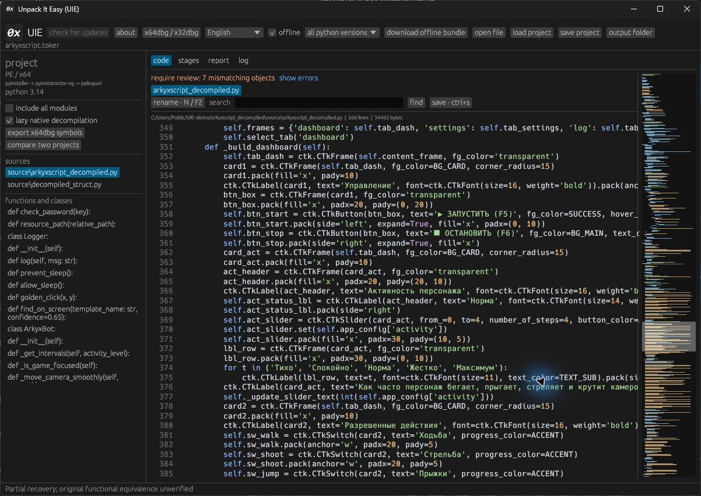

<div align="center">


# Unpack It Easy

### Open a file. Find its format. Read what can be recovered.

Recover Python, C#, Java and archive sources, inspect native pseudocode, and keep the results in one desktop workspace.

**Written in Rust · Local analysis · Portable `.uie` projects**

[](https://github.com/xreamm1/unpack-it-easy/releases/latest/download/UIE.exe)
[](https://github.com/xreamm1/unpack-it-easy/releases/latest)

[](https://github.com/xreamm1/unpack-it-easy/actions/workflows/build.yml)
[](https://github.com/xreamm1/unpack-it-easy/releases)
[](https://github.com/xreamm1/unpack-it-easy/stargazers)
[](LICENSE)

[](#quick-start)
[](#what-can-i-open)
[](docs/linux.md)
[](https://github.com/xreamm1/unpack-it-easy/issues/new)

</div>

## See the recovered code

[](assets/code-demo.gif)

*Actual UIE interface, browsing Python previously recovered from `arkyxscript`. The demo shows code navigation, not a timed decompilation. Recovery of this sample is partial; the review notice remains visible.*

<details>
<summary>Open a still screenshot</summary>

[](assets/workspace.png)

</details>

## From file to an inspectable project

Drop in a file and UIE identifies its format, chooses an analysis route, prepares the required engine, and opens the available code with its report. You can follow progress, jump to functions, rename symbols and save the whole workspace for later.

| Identify | Recover | Explore |
| --- | --- | --- |
| Architecture, compiler and packer hints, hashes and indicators | Archive contents, language sources or native pseudocode | Function navigation, minimap, search, reports and `.uie` projects |

UIE brings the tools together and adds its own Rust analysis passes. You do not need to assemble a separate workflow for each supported format.

## Quick start

1. **[Download UIE.exe](https://github.com/xreamm1/unpack-it-easy/releases/latest/download/UIE.exe)** for Windows x64 and place it in a writable folder.
2. Launch it and drop a file into the window, or choose **open file**.
3. Let UIE prepare the required analysis engines. First-time setup needs internet access and can take several gigabytes of disk space.
4. Follow the stages, open the results and save your work as a **`.uie` project**.

Keep the downloaded `engines` folder beside `UIE.exe`. You do not need to install a system Python for the GUI. English is the default; Russian is available in the toolbar.

**Other platforms:** [Linux setup](docs/linux.md) · [macOS setup](docs/macos.md). Source builds and native backend setup are documented; runtime coverage is limited. The ready-to-run `.exe`, automatic Windows dependency installer and x64dbg integration are for Windows.

## What can I open?

| Input | Available output |
| --- | --- |
| PyInstaller executables and Python `.pyc` | Extracted resources and recovered Python, with bytecode-equivalence reporting where available |
| Native PE, ELF and Mach-O binaries | C pseudocode and native-analysis reports |
| Nuitka and Cython builds, including launcher + `.pyd` layouts | Native C pseudocode, related modules, initialization and XREF candidates |
| .NET assemblies | C# source |
| Java `.jar` and `.class` | Java source |
| Electron `.asar` | Extracted JavaScript, TypeScript and resources present in the archive |
| UIE `.uie` projects | Saved code, resources, reports and rename history |

**Recovery depends on the input.** Native pseudocode is not the original source, and full Python recovery or decryption of Nuitka Commercial builds is not verified. Incomplete results stay marked incomplete. [Details and limits](docs/usage.md#limits-and-verification).

## Inside the workspace

- **Start with an index.** The Rust PE AMD64 pass finds file-backed function candidates first. With lazy native analysis, request a function's pseudocode when you select it instead of decompiling every body up front.
- **Inspect more than pseudocode.** Bounded Rust passes track constants, simple XOR/shift/rotate operations, string candidates and constant-XOR CRC32 tables. Results carry addresses and evidence limits.
- **See what is happening.** Stage timers, object counters, logs and links from reported problems to the affected code.
- **Get an early picture.** Compiler and packer signatures, MD5/SHA-1/SHA-256, URLs, IPs, paths, webhook strings and selected WinAPI indicators. External hash lookups are optional; files are not automatically uploaded.
- **Browse larger outputs.** Virtualized viewing, a clickable minimap, search and a function tree. Rename identifiers with **N / F2** and keep the history in your project.
- **Inspect native Python builds.** Related-module discovery, CRT filtering, constant-initializer candidates, section entropy and Python-string XREFs.
- **Keep your work.** Save portable `.uie` databases, copy or export logs, and reopen edited files with their resources.
- **Compare and continue elsewhere.** Compare projects and export native symbols and comments for x64dbg.
- **Use a debugger when needed.** Optional x64dbg/x32dbg integration on Windows. Starting a sample under the debugger is an explicit action; normal static analysis does not run input executables.

UIE combines its Rust passes with Detect It Easy, Ghidra, RetDec, PyLingual, ILSpy, CFR and UPX where applicable. Analysis backends retain their own capabilities and limits. See [third-party components and licenses](THIRD_PARTY.md).

## Prepare once, work offline

While online, choose the Python version you need and click **download offline bundle**. Once preparation finishes, enable **offline** to stop automatic downloads and update checks.

Copy `UIE.exe` together with `engines` to move the prepared installation. Python 3.8–3.14 can be selected; the all-versions option needs multiple gigabytes. Model downloads retain resumable partial files, and successful version preparation is recorded. Missing components are reported instead of fetched while offline.

[Offline setup and command-line usage](docs/usage.md#offline-mode) · [Troubleshooting and crash reports](docs/usage.md#crash-reports-and-backtraces)

## Help improve UIE

If UIE saves you setup time, **[give the repo a star](https://github.com/xreamm1/unpack-it-easy/stargazers)** or share a reproducible sample that helps improve recovery.

Found a crash, a failed extraction or an incorrect result? [Open an issue](https://github.com/xreamm1/unpack-it-easy/issues/new) with your OS, UIE version, the failing stage and the exported log. Include a small reproducible sample when you can share it, and remove private paths, tokens and other sensitive data from logs before posting.

You can also support new-format work and bug fixes through **about → support development** in the app. Contributions and reproducible bug reports are welcome too.

## Build from source

On Windows, install Rust and the MSVC C++ build tools:

```cmd
cargo build --release --locked
```

Output: `target\release\UIE.exe`. For Linux prerequisites, see [the Linux guide](docs/linux.md).

<details>
<summary>Development checks</summary>

```cmd
cargo fmt --check
cargo clippy --all-targets --locked -- -D warnings
cargo test --locked
```

</details>

[Technical notes](docs/usage.md) · [Native recovery and limits](docs/native-recovery.md) · [Backend evaluation](docs/backend-evaluation.md) · [MIT license](LICENSE)
